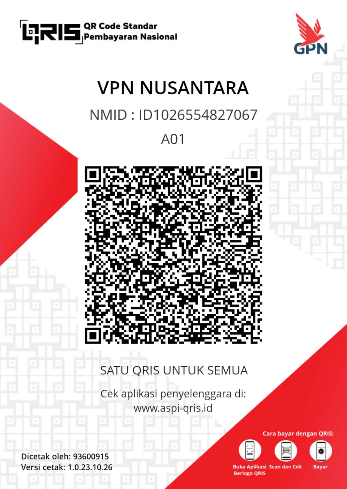

# 📡 ZTE MF90 Modem Manager

**Aplikasi Pengelola Modem ZTE MF90 – Kontrol Jaringan Internet dalam Satu Genggaman.**

ZTE MF90 Modem Manager adalah aplikasi Android yang dirancang untuk memudahkan pengguna mengelola dan mengatur modem MiFi ZTE MF90 langsung melalui smartphone.

Dengan tampilan modern, navigasi sederhana, dan berbagai fitur pengelolaan modem, aplikasi ini hadir untuk memberikan pengalaman konfigurasi modem yang lebih praktis.

## ✨ Fitur Aplikasi

- 📶 Dashboard informasi modem.
- 🌐 Pengaturan jaringan internet.
- 📡 Pengaturan nama WiFi (SSID).
- 🔐 Pengaturan password WiFi.
- 👥 Manajemen perangkat yang terhubung.
- 📊 Informasi status koneksi.
- 🌍 Informasi jaringan dan operator.
- ⚙️ Akses pengaturan modem melalui `192.168.0.1`.
- 📱 Tampilan modern dan mudah digunakan.
- 🔧 Dukungan pengembangan untuk firmware ZTE MF90.

## 📱 Informasi Kompatibilitas

| Keterangan | Informasi |
|---|---|
| Nama aplikasi | ZTE MF90 Modem Manager |
| Platform | Android |
| Perangkat | ZTE MF90 |
| Firmware | Beeline / lainnya |
| IP Modem | 192.168.0.1 |
| Koneksi | WiFi modem |

## 🚀 Roadmap Pengembangan

Fitur yang direncanakan untuk pengembangan berikutnya:

- [ ] Penyempurnaan dashboard modem.
- [ ] Pengembangan pengaturan WiFi lebih lengkap.
- [ ] Penambahan pilihan negara.
- [ ] Pengembangan konfigurasi jaringan.
- [ ] Peningkatan kompatibilitas firmware Beeline.
- [ ] Eksplorasi dukungan WiFi 5 GHz jika perangkat keras mendukung.
- [ ] Optimalisasi tampilan dan pengalaman pengguna.
- [ ] Perbaikan bug dan peningkatan stabilitas.

## ❤️ Dukung Pengembangan Aplikasi

Pengembangan aplikasi ini membutuhkan waktu, tenaga, dan biaya.

Dukungan Anda sangat berarti untuk membantu menghadirkan fitur baru, memperbaiki bug, meningkatkan kompatibilitas, serta mengembangkan ZTE MF90 Modem Manager menjadi aplikasi yang lebih lengkap.

### 💝 DONASI PENGEMBANGAN

  
   
  <b>Support ZTE MF90 Modem Manager ❤️</b>
   
  Scan QRIS untuk berdonasi.

Jika aplikasi ini bermanfaat bagi Anda, silakan berikan dukungan melalui QRIS.

Setiap donasi, berapa pun jumlahnya, sangat berarti bagi kelanjutan proyek ini.

**Terima kasih telah mendukung pengembangan ZTE MF90 Modem Manager!**

## 🤝 Kontribusi

Kami terbuka terhadap:
- Saran dan masukan.
- Laporan bug.
- Permintaan fitur baru.
- Kontribusi pengembangan dari komunitas.

## ⚠️ Disclaimer

ZTE MF90 Modem Manager merupakan aplikasi independen dan bukan aplikasi resmi ZTE Corporation.

Ketersediaan fitur bergantung pada perangkat keras, firmware, dan dukungan antarmuka modem yang digunakan.

## ❤️ Terima Kasih

**Made with ❤️ for ZTE MF90 Users.**

© 2026 ZTE MF90 Modem Manager.